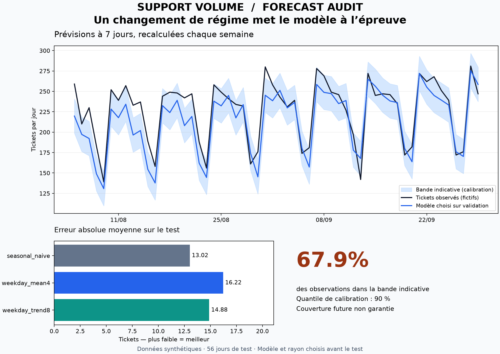

# Support Volume Forecast

**Peut-on faire confiance à la prévision de charge de la semaine prochaine ?** Un projet de forecasting qui compare trois méthodes simples, sépare sélection, calibration et test, et conserve la trace du dernier jour connu pour chaque prévision.

Cas métier : estimer le volume quotidien de tickets d'un service client. Le projet produit les sept prochaines valeurs prévues et une bande indicative. Il n'effectue pas de planification d'effectifs : cela nécessiterait durées de traitement, horaires et objectifs de service.

**Python standard pour le moteur · données fictives · aucune API · évaluation chronologique.**



## Démarrage rapide

Python 3.10+ ; moteur et tests vérifiés avec Python 3.14.3 sous Windows.

```sh
git clone https://github.com/abdelouahabmoulinepro-coder/support-volume-forecast.git
cd support-volume-forecast
python forecast.py --output build
python -m unittest discover -s tests -v
```

Les données sont déjà fournies. Pour les régénérer : `python generate_demo.py`.

Lire `build/report.md` et `build/forecast.csv`. Les résultats de référence sont disponibles dans [example/report.md](example/report.md) et [example/results.json](example/results.json).

La figure est facultative et nécessite Python 3.11+ avec Matplotlib ; pour la reconstruire :

```sh
python -m pip install -r requirements-plot.txt
python plot_results.py build/results.json --output build/forecast-audit.png
```

## Résultats mesurés — y compris l'échec du modèle sélectionné

Le modèle choisi sur validation est **`weekday_mean4`**. Après une hausse de niveau introduite dans la série synthétique, il est moins précis que la référence saisonnière sur le test.

| Méthode | MAE (tickets/jour) | RMSE | Biais prévision − réel | WAPE |
|---|---:|---:|---:|---:|
| Même jour de la semaine précédente | **13,02** | 17,11 | −5,41 | 5,74 % |
| Moyenne des 4 mêmes jours précédents — sélectionnée | 16,22 | 19,66 | −12,40 | 7,16 % |
| Tendance par jour sur 8 semaines | 14,88 | 18,08 | +0,73 | 6,57 % |

La bande de ±21 tickets ne couvre que **67,9 %** des 56 observations de test. Son rayon avait été calculé à partir du quantile 90 % des erreurs absolues d'une période de calibration antérieure. Le décalage de distribution dégrade donc également l'estimation d'incertitude.

Ces résultats sont publiés tels quels : le modèle n'est pas remplacé après consultation du test. La référence et la troisième méthode sont affichées pour l'audit, pas pour sélectionner rétrospectivement un vainqueur déployé.

## Protocole chronologique

| Bloc de la démo | Période | Jours | Rôle |
|---|---|---:|---|
| Historique initial | 01/10/2025–17/02/2026 | 140 | Historique disponible au premier départ |
| Validation | 18/02/2026–12/05/2026 | 84 | Choix de la méthode par MAE |
| Calibration | 13/05/2026–04/08/2026 | 84 | Calcul du rayon d'erreur pour la méthode choisie |
| Test | 05/08/2026–29/09/2026 | 56 | Évaluation finale, sans changement de méthode ni de rayon |

À chaque départ hebdomadaire, le moteur prédit **sept jours en une fois**, en utilisant seulement les observations antérieures. Il avance ensuite de sept jours : les réalisations de la semaine terminée deviennent disponibles pour la prévision suivante. C'est une évaluation à origine glissante avec mise à jour hebdomadaire, pas une prévision unique à 56 jours.

Les modèles utilisent des fenêtres de 7, 28 ou 56 jours. L'historique disponible augmente au fil du temps, mais leurs fenêtres restent fixes. Aucun mélange aléatoire des dates, aucune imputation par des valeurs futures et aucun ajustement du rayon sur le test.

Pour un autre fichier, les 224 derniers jours sont toujours répartis en validation 84 jours, calibration 84 jours et test 56 jours. Au moins 56 jours doivent précéder ces blocs, soit **280 observations minimum**.

## Trois modèles explicables

- `seasonal_naive` : répéter les sept derniers jours, donc le même jour de la semaine précédente.
- `weekday_mean4` : moyenne des quatre observations précédentes correspondant au même jour de la semaine.
- `weekday_trend8` : ajuster séparément une droite des moindres carrés pour chaque jour de la semaine, sur huit observations hebdomadaires, puis extrapoler une semaine. Les prévisions négatives sont ramenées à zéro.

Les fenêtres sont fixées avant l'évaluation. La méthode ayant la plus faible MAE de validation est retenue ; en cas d'égalité, l'ordre ci-dessus privilégie la référence simple.

La moyenne et la tendance ne sont pas arrondies avant calcul des métriques. Les valeurs prévues peuvent être fractionnaires : ce sont des estimations de volume, pas des tickets individuels.

## Incertitude : une bande empirique, pas une garantie

Le rayon est l'erreur absolue au rang `ceil(0,9 × n)` parmi les erreurs triées de calibration. Les 84 erreurs sont mutualisées entre horizons 1 à 7. La borne basse est limitée à zéro.

Ce calcul n'est pas un intervalle de confiance sur une moyenne ni une garantie de couverture conforme. Les erreurs sont temporellement dépendantes ; saisonnalité, changement de régime et petit échantillon peuvent modifier la couverture. Le rayon reste figé lors du test et pour les sept jours suivants, afin de rendre le diagnostic vérifiable.

## Entrées et sorties

Entrée : une liste JSON de la forme `{"date": "2026-01-01", "tickets": 150}`. Il faut entre 280 et 10 000 observations journalières triées, uniques et sans trou. Chaque volume doit être un entier de 0 à 10 millions. Les valeurs manquantes, négatives, décimales et booléennes sont refusées. Une date absente n'est jamais interprétée comme zéro ticket.

```sh
python forecast.py data/daily_tickets.json --output build
```

| Fichier | Contenu |
|---|---|
| `results.json` | Découpage, choix, métriques, scores par horizon, prédictions de test et dates de fin d'historique |
| `report.md` | Comparaison des méthodes et couverture de la bande |
| `forecast.csv` | Les sept jours après la dernière observation, prévisions et bornes |

Le JSON inclut une empreinte SHA-256 de l'entrée normalisée. Les sorties du dossier choisi sont remplacées ; utiliser des dossiers différents pour préserver plusieurs analyses. Code de sortie 0 : succès ; 1 : erreur de données ou d'évaluation traitée ; 2 : erreur de syntaxe de commande. Ne pas consommer d'anciens résultats après un échec.

Métriques : **MAE** = moyenne des erreurs absolues ; **RMSE** = racine de la moyenne des erreurs au carré ; **biais** = moyenne de prévision − réel ; **WAPE** = somme des erreurs absolues / somme des volumes réels, ou `null` si le dénominateur est nul.

## Données et limites

Les **364 jours sont entièrement synthétiques**, générés avec une graine fixe `20261001` : niveau de base 130, croissance de 0,22 ticket/jour, effets hebdomadaires, bruit gaussien d'écart-type 12, puis hausse de 30 tickets/jour au début du test. La hausse est un stress choisi à la conception, pas une découverte dans des données réelles. Aucune donnée client ni donnée personnelle n'est utilisée.

Le générateur est favorable à des modèles simples avec saisonnalité hebdomadaire. Les résultats n'établissent pas une performance sur un service client réel. Les dates des prévisions de démonstration suivent l'historique fictif ; elles ne décrivent aucune activité réelle.

Le moteur ignore les jours fériés, campagnes, incidents, fermetures et covariables externes. Il traite une seule série agrégée et ne modélise pas explicitement une distribution de comptage. Pour aller plus loin : nouvelles données autorisées, variables calendaires et comparaison de modèles sur un **nouveau test intact**, après usage du test actuel pour l'analyse.

## Validation et référence méthodologique

**14 tests automatisés** couvrent les calculs sur exemples connus, la continuité des dates, les métriques, les séries nulles et la reproductibilité. Deux tests modifient délibérément les valeurs futures pour vérifier qu'elles ne changent ni leurs propres prévisions, ni le choix du modèle, ni le rayon de calibration.

La démarche s'appuie sur l'[évaluation chronologique décrite par Hyndman et Athanasopoulos](https://otexts.com/fpp2/accuracy.html). Le code des méthodes et du protocole est original.

Licence MIT : voir [LICENSE](LICENSE).
